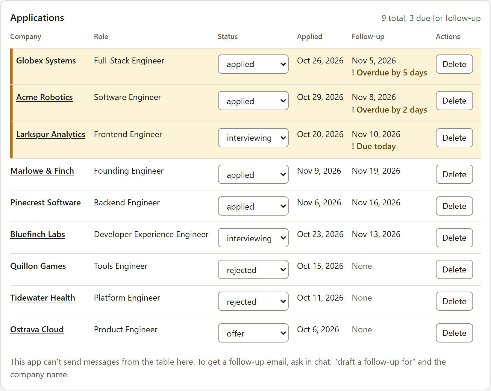

# Application Tracker

A small MCP App that shows a job-application pipeline as an interactive table inside Claude. It is built with the open-source [`mcp-use`](https://github.com/mcp-use/mcp-use) TypeScript SDK (v2.12.3) and deployed on Manufact Cloud.

I built it to use the SDK for real: scaffold, tools, a View, tests, deploy, and a real client. The notes I kept along the way are in [FRICTION.md](FRICTION.md).



**Fake data only.** Every row belongs to a fictional applicant, Jane Doe, and every company is made up. Nothing here comes from a real application log.

## Try it

Deployed MCP endpoint:

```
https://fast-steel-8vnyl.run.mcp-use.com/mcp
```

In Claude, go to **Customize → Connectors → Add → Add custom connector**, paste the URL, and choose **No sign in**. Then try:

- "Show my applications"
- "What follow-ups are due?"
- "Mark Acme as interviewing"
- "Draft a follow-up for Globex"
- "Add an application to Halden Works for Staff Engineer, applied today"

Two things to expect from a public demo:

- **The data is shared.** Everyone who connects edits the same rows.
- **The data resets.** It lives in memory, so it returns to the seed whenever the server sleeps (the free tier scales to zero) or redeploys.

## What it does

Six tools:

| Tool | What it does |
| - | - |
| `list_applications` | Every application, due follow-ups first. Renders the table View. |
| `followups_due` | Only the applications whose follow-up date is today or earlier. |
| `add_application` | Adds one; the follow-up date defaults to 10 days after applying. |
| `update_application` | Changes status, follow-up date, link or role. |
| `delete_application` | Removes one by id. |
| `draft_followup` | Returns the application's details and writing guidance, so the model in the chat writes the email. The server makes no LLM call and holds no API key. |

One View, bound to `list_applications`:

- Due rows come first and are marked three ways (a thicker edge, a tint, and "Overdue by N days" text), so the signal never depends on colour.
- Each row has a status dropdown and a Delete button with a confirmation step. Both call the tools directly and redraw from the server's answer.
- "Draft follow-up" posts a message into the chat so the model writes the email. It appears only where the host accepts messages from a View.
- Below 640px the table becomes labelled cards. Every control has a visible keyboard focus ring, and both light and dark themes are supported.

A few rules worth knowing:

- Dates are `YYYY-MM-DD`, and "today" is the server's UTC date, so "due today" can be off by a day near midnight in other time zones.
- Marking an application `rejected` or `offer` removes its follow-up date.
- Tools take an id (`app-3`); the model finds it with `list_applications`.

## How it is put together

```
index.ts               server and tool registration
src/types.ts           Application and Status
src/dates.ts           pure date logic (isFollowUpDue, default follow-up)
src/store.ts           pure store functions: list, add, update, delete
src/seed.json, seed.ts nine fictional rows stored as day offsets
src/schemas.ts         Zod input and output schemas
src/handlers.ts        tool handlers as plain functions
views/pipeline/        the table View (React)
```

The store and the handlers know nothing about MCP. `index.ts` only wires them to `server.tool`, which is what makes them easy to test.

The seed stores offsets ("applied 12 days ago, follow-up 2 days ago"), not dates. Real dates are computed when the server starts, so the demo always shows a mix of due and not-due rows.

## Run it locally

Requires Node 22.22.2 or later and pnpm.

```bash
pnpm install
pnpm dev          # server at http://localhost:3000/mcp
```

Open the Inspector at http://localhost:3000/mcp/inspector and run `list_applications`.

## Tests

```bash
pnpm test         # 93 tests, Vitest
pnpm run typecheck
```

The tests cover the date logic (due today, yesterday, tomorrow, no follow-up date), every store function, and every tool handler with valid input, invalid input and an unknown id. The View has no unit tests; I checked it in the Inspector, with `mcp-use screenshot`, and in Claude.

## What I noticed

The full list, with what I expected in each case, is in [FRICTION.md](FRICTION.md). The three that cost the most time:

- **The first click in a new project fails.** The template's landing page at `localhost:3000/mcp` has an "Open in Inspector" button that goes to the hosted Inspector, which cannot reach a local server. The error it shows ("403: Version negotiation failed") points away from the cause. The local Inspector at `/mcp/inspector` works.
- **There is no path for testing.** The scaffold has no test runner and the docs have no recipe for testing a tool handler. Separating handlers from `server.tool` worked well, and one example test in the template would have saved the guesswork.
- **A View's follow-up button cannot be tested locally.** The docs say to hide a `useSendFollowUp` control unless the host declares the `message` capability, and neither the Inspector's tool preview nor its Chat tab declares it. The docs also have no table of which hosts render Views at all: Gemini ran the tools but drew its own table.

What worked well: the scaffold ran first time, schema validation errors were readable without any work from me, the View hooks were typed from the server's tool exports with no extra setup, and the deploy from a private GitHub repo succeeded on the first attempt.
