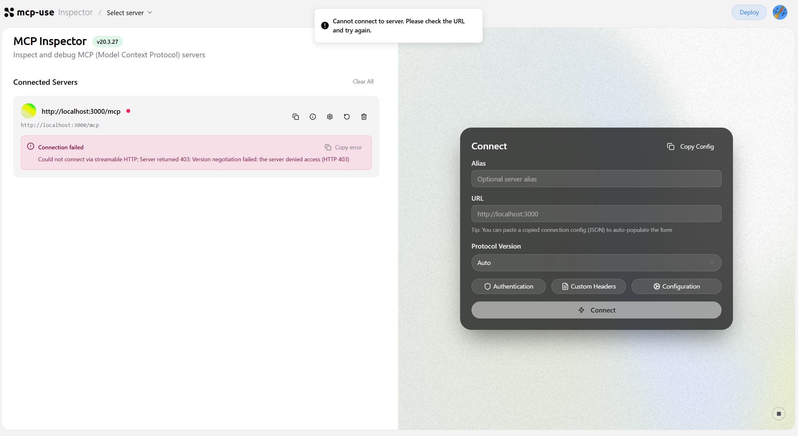

# Issue draft for mcp-use/mcp-use

Not posted. Use the **Bug report** template at https://github.com/mcp-use/mcp-use/issues/new/choose and paste the body below over the template text. The headings match the template's.

---

**Title:** landing: "Open in Inspector" on a local dev server opens the hosted Inspector, which fails with "403: Version negotiation failed"

---

**Describe the bug**

On a freshly scaffolded project, the landing page at `http://localhost:3000/mcp` has an "Open in Inspector" button. It opens the hosted Inspector with the local server as the target:

```
https://inspector.manufact.com/inspector?autoConnect=http%3A%2F%2Flocalhost%3A3000%2Fmcp&tab=chat
```

The hosted Inspector then fails to connect and shows:

```
Could not connect via streamable HTTP: Server returned 403: Version negotiation failed: the server denied access (HTTP 403)
```

The local Inspector at `http://localhost:3000/mcp/inspector` connects to the same server without any problem, so the server itself is fine. For someone new to mcp-use this is the first button on the first page of a new project, and the error points at a protocol or auth problem rather than "this page cannot reach your machine".

**To Reproduce**

1. Scaffold and start the starter:
   ```sh
   pnpm dlx create-mcp-use-app@latest repro --template mcp-apps --install
   cd repro
   pnpm dev
   ```
2. Open `http://localhost:3000/mcp` in a browser.
3. Click **Open in Inspector**.
4. See the 403 error above in the hosted Inspector.

The dev server log for that attempt shows the page load followed by two rejected preflights:

```
[server] GET /mcp 200 37ms
[server] OPTIONS /mcp 405 3ms
[server] OPTIONS /mcp 405 0ms
```

The preflight can be reproduced without a browser:

```sh
curl -i -X OPTIONS http://localhost:3000/mcp \
  -H "Origin: https://inspector.manufact.com" \
  -H "Access-Control-Request-Method: POST" \
  -H "Access-Control-Request-Headers: content-type"
```

```
HTTP/1.1 405 Method Not Allowed
content-type: application/json

{"jsonrpc":"2.0","error":{"code":-32000,"message":"Method not allowed."},"id":null}
```

A plain `POST` of `tools/list` to the same endpoint returns 200 whatever `Origin` header is sent, so only the preflight is refused.

**Expected behavior**

Either of these would fix the first run:

- When the server URL is a loopback address (`localhost`, `127.0.0.1`, `[::1]`), point the landing page's Inspector link at the server's own Inspector (`<mcp url>/inspector`), which `mcp-use dev` already serves.
- Or keep the link, and have the hosted Inspector detect a loopback `autoConnect` target and say so plainly, for example: "This Inspector runs on the internet and cannot reach localhost. Open http://localhost:3000/mcp/inspector instead, or start a tunnel with `mcp-use dev --tunnel`."

**Screenshots**



**Desktop (please complete the following information):**
 - OS: Windows 11
 - Browser: Chrome
 - Version: `mcp-use` 2.12.3, `create-mcp-use-app` 2.1.1, Inspector 20.3.28, Node 26.13.0, pnpm 12.18.0

**Additional context**

Why it fails: with default settings, both of the hosted Inspector's connection paths are closed to a local server, each for a good reason.

- The landing page always links to the hosted Inspector. `getInstallTargets` builds the link from a fixed origin, whatever the server's URL is ([`install-targets.ts` L178–189](https://github.com/mcp-use/mcp-use/blob/main/libraries/typescript/packages/server/src/install-targets.ts#L178-L189), unchanged on `main` and `canary`).
- **Direct** can't work: `MCPServer` serves no CORS headers unless `cors` is set ("Off when omitted", `ServerConfig.cors`), so the preflight gets a 405 and the browser blocks the request.
- **Via Proxy** can't work: since #2134 the hosted Inspector's proxy refuses loopback targets, which returns 403. Auto mode tries Direct, then falls back to the proxy (per the Connection settings docs), which is why the user sees a 403. I haven't seen the hosted proxy's response myself; this part comes from the docs and #2134, not from my own testing.

So I don't think either safety default should change. The problem is that the landing page sends local users down a path that can't succeed, and the error doesn't tell them why.

I searched open and closed issues and pull requests for "Open in Inspector", "Version negotiation failed", "inspector localhost 403" and `getManufactInspectorUrl` and did not find this reported or being worked on.

I'd like to work on a fix for the first option if that's the direction you want. Could you assign it to me?
